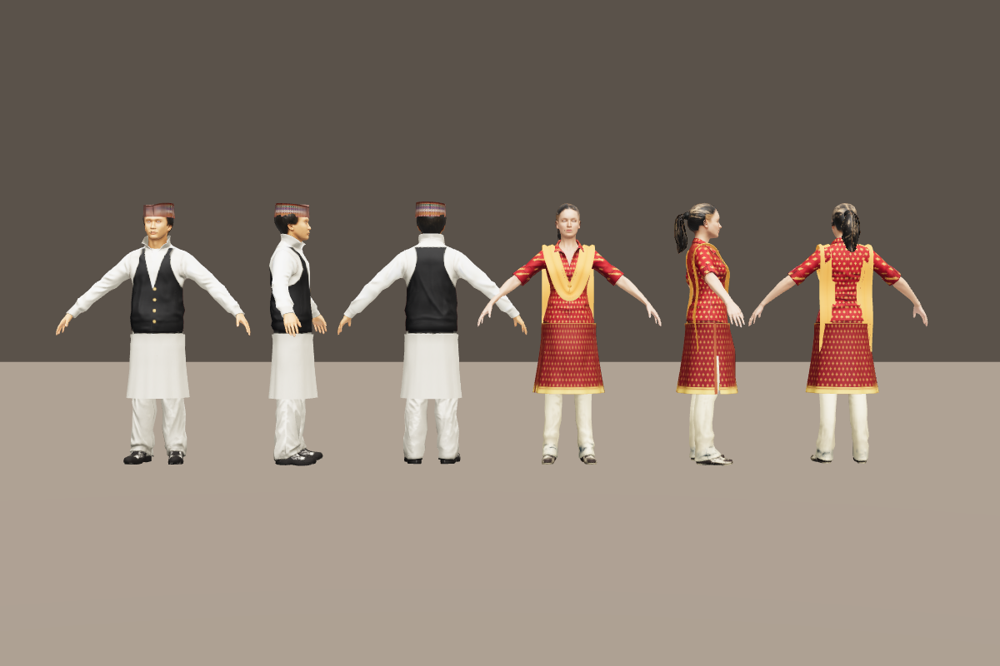

# Our House — a private two-player 3D mansion

A web-native, real-time 3D home for two people. The host creates a room and shares a key; the guest
enters it, and the two of them, a young man and a young woman in Nepali dress, walk through a cathedral-scale
palace of five rooms. Eighteen photos, grouped by theme, hang behind velvet curtains that part as you approach,
and a grand staircase climbs to the Upper Sunset Balcony.

Deep dives: [docs/ROOMS.md](docs/ROOMS.md) (the five rooms, the grand stair, practical lights) ·
[docs/PERFORMANCE.md](docs/PERFORMANCE.md) (90+ fps architecture, zone culling, KTX2 pipeline) ·
[docs/GALLERY.md](docs/GALLERY.md) (curtain mechanic, VRAM lifecycle, sync).

```
buffer-zone/
├── client/                React Three Fiber + Drei + Rapier + Vite
│   ├── index.html
│   ├── .env.example       VITE_SERVER_URL
│   ├── vite.config.js     code-splitting for the 3D engine
│   ├── public/            static, cacheable assets (served as-is)
│   │   ├── models/        mansion.glb (Sponza interior), avatars/{boy,girl}.glb (committed), animations/locomotion.glb
│   │   ├── hdri/          venice_sunset_1k.hdr (image-based lighting)
│   │   ├── photos/        your photos, referenced by gallery/photos.js (placeholders until you add yours)
│   │   ├── audio/         footstep.wav, romantic-theme.wav (placeholders until you add yours)
│   │   ├── draco/gltf/    Draco decoder   } copied from three on npm install
│   │   └── basis/         KTX2 transcoder }  (scripts/copy-decoders.mjs)
│   └── src/
│       ├── main.jsx · App.jsx · styles.css
│       ├── lobby/         Lobby.jsx: create room / enter key (shows offline state)
│       ├── ui/            ErrorBoundary.jsx: a failed asset shows a message, not a blank page
│       ├── net/           socket.js: Socket.io client + event bridge
│       ├── state/         session.js: zustand (UI state, reconnect token); perf.js: rendering tier
│       ├── world/         config.js (tuning + asset URLs), shared.js (per-frame state), rooms.js (rooms, music,
│       │                  practical lights), visibility.js + VisibilityBake.jsx (zone culling)
│       ├── input/         useKeys.js
│       ├── scene/         GameScene.jsx (Canvas), Lighting.jsx (IBL, follow-sun shadows, post tiers),
│       │                  Mansion.jsx (lazy GLB + colliders), GrandStair.jsx (stair to the balcony),
│       │                  Practicals.jsx (hearth, lamps, pooled point lights), stone.js (instanced stone),
│       │                  PerfGovernor.jsx (adaptive DPR and tier), loaders.js (Draco + KTX2 workers),
│       │                  Loading.jsx (DOM progress overlay)
│       ├── avatar/        Avatar.jsx (blend tree, head-look), retarget.js (clip retargeting),
│       │                  LocalPlayer.jsx (character controller + camera + sync), RemotePlayer.jsx
│       ├── gallery/       PhotoFrames.jsx, CurtainPhotoFrame.jsx, GalleryBatch.jsx (instanced), curtainMaterial.js,
│       │                  textureCache.js (LRU VRAM), curtainState.js (sync), photos.js (your data)
│       ├── audio/         SpatialAudio.jsx (room music + positional footsteps)
│       ├── hud/           Hud.jsx (room key, room name, photo caption overlay)
│       └── utils/         math.js (damped smoothing)
├── server/                Node 20+ · Socket.io 4
│   └── src/
│       ├── index.js       HTTP + Socket.io, rate limits, 20 Hz fan-out, graceful shutdown
│       ├── rooms.js       room registry: keys hashed, tokens for reconnect, cleanup
│       └── validate.js    pure input checks: key normalisation, payload sanitising
├── server/test/           node:test unit tests (run: npm test)
├── docs/                  ROOMS.md, PERFORMANCE.md, GALLERY.md
└── scripts/               copy-decoders.mjs, fetch-assets.mjs, make-standins.mjs,
                           dress-avatars.py + avatar_tools/ (builds the Nepali-dressed avatars)
```

---

## 1. Architecture

### 1.1 Frontend

| Concern | Choice | Why |
|---|---|---|
| Renderer | React Three Fiber 9 + Three.js r170 | Declarative scene, React state for UI, imperative `useFrame` for the hot path |
| Helpers | `@react-three/drei` | `useGLTF`, `useAnimations`, `Environment`, `Html` |
| Post | `@react-three/postprocessing` (SSAO, Bloom, DoF, ACES) | Composed pass chain; `multisampling={0}` avoids MSAA cost |
| Physics | `@react-three/rapier` (WASM) | Capsule character, trimesh walls, no tunnelling at 60 fps |
| Net | `socket.io-client`, WebSocket only | Skips the long-poll upgrade; lower latency |
| State | `zustand` | Tiny store; per-frame data stays in plain objects (`world/shared.js`) |
| Build | Vite 6 | Fast dev, code-splitting, Draco/KTX2 aware |

**Rule:** no React state in the render loop. Positions, velocities and blend weights live in mutable
objects and are read in `useFrame`. React only renders UI that changes at human speed (lobby, captions, key card).

### 1.2 Backend

Single Node process, in-memory rooms (`server/src/rooms.js`).

- **Room key:** 8 characters from a 31-symbol alphabet with no look-alikes. ~40 bits of entropy.
  Only a SHA-256 hash is stored; the plaintext key goes to the host once.
- **Join protection:** per-socket cap of 8 wrong keys, then the socket is refused. Keys are normalised, so `abcd-efgh`, `ABCDEFGH` and `abcd efgh` all work.
- **Reconnect:** each seat has a 24-byte random token (in `sessionStorage` only) so a refresh reclaims your seat.
  Cleanup of an empty room runs after 60 s.
- **Sync:** the client sends `player:update` at 20 Hz (`volatile`). The server validates and clamps every
  field, then fans out each seat's latest state to its partner at 20 Hz, only when it changed.
- **Inbound cap:** 66 Hz per socket. Excess packets are dropped rather than queued.

### 1.3 Network protocol

| Direction | Event | Payload | Notes |
|---|---|---|---|
| C→S | `room:create` (ack) | — | → `{ roomId, key, role:'host', token }` |
| C→S | `room:join` (ack) | `{ key }` | → `{ roomId, role:'guest', token, peerConnected }` |
| C→S | `room:resume` (ack) | `{ roomId, token }` | Reclaim a seat after reconnect |
| C→S | `player:update` (volatile) | `{ p:[x,y,z], r, a, v }` | 20 Hz |
| S→C | `world:peer` (volatile) | `{ p, r, a, v, t }` | Partner's latest state, 20 Hz |
| S→C | `room:peer` | `{ connected }` | Partner joined or left |
| C→S | `gallery:curtain` | `{ id, open }` | Click: hold open/closed, or `null` to release (burst 20, 10/s) |
| S→C | `gallery:curtain` | `{ id, open }` | The partner's click, mirrored |
| S→C | `gallery:state` | `{ [id]: bool }` | Held curtains, sent on join and resume |

Bandwidth: about 60 bytes × 20 Hz × 2 directions ≈ 2.4 KB/s per player. Latency is one network RTT plus
the interpolation delay (`INTERP_DELAY_MS = 110` in `world/config.js`).

### 1.4 Motion and animation

- **Local player:** a kinematic capsule (1.8 m, radius 0.35 m) moved by Rapier's character controller. It
  shape-casts, so it can't tunnel through walls at sprint speed; it steps up kerbs to 0.3 m (where there's
  25 cm to stand on, so urns and balustrade bases stay obstacles), snaps to the ground going down, climbs the
  grand stair's 32° ramp, and treats slopes over 50° as walls. Walk 3.5 m/s, sprint 8 m/s, with eased acceleration
  (λ = 10) and a slightly faster stop (λ = 14). The house is scaled 1.5× (`MANSION_SCALE`) to cathedral size.
- **Blend tree:** a 1-D tree on ground speed, idle → walk (3.5 m/s) → run (8 m/s), with linear cross-weights
  that sum to 1. Weights are damped every frame (`λ = 8`), so transitions never pop. Each clip plays at
  speed ÷ its capture speed (`CLIP_REFERENCE_SPEED`), so feet don't slide.
- **Partner:** visual only, no collider. Each server snapshot is stamped with the local receive time, and the partner is
  rendered `INTERP_DELAY_MS` in the past, blending between the two snapshots that bracket that moment. This needs no clock
  sync between machines, and it holds the last pose if packets stop instead of extrapolating.
- **Camera:** a third-person follow camera, 5.5 m back and 2.4 m up, FOV 60°, near 0.1 / far 250. A Rapier ray from the
  look point to the camera pulls the camera in when a wall is in the way, so the view never clips through the house.
- **Phase lock:** while walk and run blend, the run clip is set to walk's point in its cycle, so the legs don't ghost.
- **Avatars:** the host is the boy, the guest the girl (`AVATAR_BY_ROLE`). Both are realistic Microsoft Rocketbox
  characters (MIT licence), dressed in Nepali clothes (see [Nepali dress](#nepali-dress)). Both play one shared
  motion-capture set (Mixamo idle, walk and run, from the Xbot file), retargeted onto each rig when it loads
  (`avatar/retarget.js`). The retarget poses the source skeleton
  in world space and carries each bone's rotation from its own rest pose onto the target bone's rest pose, so it
  copes with different armature rotations and units, T-pose versus A-pose rests, rigs that face -Z instead of +Z, and
  different hierarchies (a 3ds Max Biped hangs the thighs from the spine and the collarbones from the neck).
  Hips translation is rescaled by the ratio of hip heights, so a shorter or taller body keeps its feet on the floor.
- **Head-look:** when the partner is within 4.5 m and roughly in front, each avatar eases its neck (40 %) and head
  (60 %) toward the partner's eyes, up to 70° sideways and 25° up or down, layered on top of the animation.

### 1.5 Rendering pipeline

```
Environment (IBL)                  ─┐
Follow-sun (avatar shadows only)    │
Spotlight pool (2, paintings)       ├─► Scene ─► [SSAO*] ─► Bloom ─► [DoF*] ─► ToneMapping ─► grade (LUT) ─► screen
Practical pool (3 point lights,    ─┘                                   * cinematic tier only
  10 m reach, nearest visible lamps)
```

The tier is chosen by `PerfGovernor` from the measured frame rate (target min(refresh, 90) fps), or forced with
`?quality=low|high|cinematic`. See [docs/PERFORMANCE.md](docs/PERFORMANCE.md).

### 1.6 Interaction and audio

- **Curtain gallery:** each photo hangs behind a velvet curtain that parts within 3.5 m, or on a click that is
  synced to the partner. Photos load only when first revealed and are released when far away. See
  [docs/GALLERY.md](docs/GALLERY.md).
- **Rooms:** five rooms in `world/rooms.js` (Grand Atrium, Memory Corridor, Study & Library, Living Salon & Hearth,
  Upper Sunset Balcony). Each has a music weight, crossfaded over 6 m at room edges, and its name fades in on the HUD
  when you enter. See [docs/ROOMS.md](docs/ROOMS.md).
- **Partner footsteps:** a `PositionalAudio` anchored to the partner. Cadence = speed ÷ 0.9 m per stride,
  so it speeds up on a run and stops when they stop. Falls off with distance (inverse model, 3 m reference, gentle rolloff for large halls).
- **Autoplay:** the Create/Join click in the lobby calls `AudioContext.resume()`. Music starts as soon as it has loaded, and on
  the next click if the browser still blocks it.

---

## 2. Asset pipeline

The goal is a first load under ~15 MB and a steady 60 fps on a mid-range laptop.

### 2.1 Budgets

| Asset | Target triangles | Textures | Compressed size |
|---|---|---|---|
| Mansion (visual) | 1–2 M total, instanced repeats | 4K PBR sets for hero surfaces, 2K elsewhere | ≤ 8 MB (GLB) |
| Mansion collision | ≤ 30 k | none | ≤ 300 KB |
| Avatar (each) | 60–100 k | 2K PBR (albedo, normal, ORM) | ≤ 3 MB |
| Animation clip | — | — | ≤ 300 KB each |
| Photos | — | 2048 px WebP, ~250 KB each | — |

### 2.2 Compression

```bash
# Draco geometry + WebP textures (pairs with the Draco decoder in public/draco/)
npx @gltf-transform/cli optimize in.glb out.glb \
  --compress draco --texture-compress webp --texture-size 2048

# Alternative: meshopt geometry + KTX2 (GPU-native, smaller decode cost)
npx @gltf-transform/cli optimize in.glb out.glb --compress meshopt --texture-compress ktx2

# Collision mesh: decimate hard, keep it watertight
npx @gltf-transform/cli simplify collision-src.glb mansion.collision.glb --ratio 0.02
```

Check the result with `npx @gltf-transform/cli inspect out.glb` before shipping.

### 2.3 Loading strategy

- **Lazy chunk:** the mansion is `lazy()`-imported, so the lobby never pulls in the engine.
- **Per-room streaming (next step):** split the house into `hall.glb`, `bedroom.glb` and so on, and load the
  neighbouring zone when the player nears its door. Keeps GPU memory bounded.
- **Preload:** once the lobby is shown, call `useGLTF.preload()` for the avatars, so the scene opens with no visible pop-in.

---

## 3. Recommended tools (2026)

I could not check these live, so verify availability, licences and pricing before you commit.

**Mansion and environment**
- **Blender** (free): clean, retopologise and bake. Export GLB with the Draco or meshopt options.
- **Poly Haven** (CC0): HDRIs for IBL, and PBR materials (wood, plaster, fabric). Use 2K–4K.
- **Sketchfab / Fab / CGTrader**: pre-made interiors. Check the licence allows a private, non-commercial use.
- **Unreal / Bridge** (free): if you want to hand-author the lighting, bake it and export the lightmaps.
- **Gaussian splats (Luma, Polycam)**: a real room scanned into a splat, for a photo-real background. Advanced.

**Avatars**
- **Microsoft Rocketbox** (MIT): 115 realistic rigged humans; the two avatars here are built from it.
- **Ready Player Me**: shut down its public service in January 2026; existing GLB files still work.
- **Character Creator 4 / Avaturn / VRoid Studio**: alternatives if RPM is unavailable.
- **Mixamo** (Adobe, free with an account): motion-captured clips for idle, walk, run. Export each as FBX, then
  convert to GLB in Blender.

**Retargeting**
- Mixamo and Ready Player Me rigs share bone names (Mixamo adds a `mixamorig` prefix), so `avatar/retarget.js`
  retargets clips at load time. For a rig with different bone names, or for production-quality results (finger
  poses, contact fixes), retarget in Blender with the **Rokoko** add-on or **Auto-Rig Pro** and export one-animation
  GLBs against the avatar's own skeleton.

**Optimisation and QA**
- **glTF-Transform** (CLI): inspect, optimise, dedupe, compress.
- **gltfpack** (meshoptimizer): a fast alternative to glTF-Transform.
- **Spector.js**: a WebGL frame-capture inspector, to find draw-call and overdraw hot spots.
- **Lighthouse / WebPageTest**: check the first load.

---

## 4. Running it

```bash
# 1. Backend
cd server && npm install && npm run dev        # http://localhost:3001/health

# 2. Frontend (new terminal)
cd client && npm install && npm run dev        # http://localhost:5173
```

Both tabs can be on one machine for testing: one tab creates a room, the other joins with the key.

Assets: download and build the house, avatars and lighting with:

```bash
cd client && npm run assets
```

This fetches Khronos **Sponza** (a stone palace interior, about 52 MB, packed to about 11 MB with Draco and WebP), the
motion-capture clips both avatars play (`animations/locomotion.glb`: Mixamo Xbot with idle, walk and run, from the three.js
examples), and a Venice sunset HDRI. If the clips can't be downloaded, box-rig stand-ins are written instead. The house is also
its own collider, so walls, columns and floors stop the player.

Licences: these files are third-party. Sponza is under the CRYENGINE Limited License Agreement and the Mixamo clips under Mixamo's
terms. They stay in your local `client/public/`, which the `.gitignore` excludes, and should not be published without checking
those terms. The HDRI is from Poly Haven (CC0). The two avatars are in the repository: they are derived from Microsoft Rocketbox
under the MIT licence (`client/public/models/avatars/LICENSE-ROCKETBOX.txt`).

### Nepali dress



`scripts/dress-avatars.py` builds `boy.glb` and `girl.glb` from two realistic Microsoft Rocketbox characters:

| | Base | Outfit |
|---|---|---|
| Boy (host) | `Male_Adult_10` | cream daura suruwal, black waistcoat with gold buttons, a Dhaka topi, black shoes |
| Girl (guest) | `Female_Adult_01` | maroon kurtha with a gold floral print and gold trim, cream surwal, a marigold dupatta; hair darkened to black |

How it works: it converts the FBX with FBX2glTF, renames the Biped bones to Mixamo names, then repaints the clothes "in 3D":
every texel of the body texture is mapped back to the point on the body it covers, so each garment is painted by body region
(torso, sleeves, legs, feet) while keeping the original folds and shading. The knee-length skirt of the daura and kurtha (the
kurtha's with side slits), the Dhaka topi (woven pattern, lopsided crown, hair pressed flat underneath) and the dupatta are
generated as skinned meshes that move with the body.

To change colours or outfits, edit the colour constants and `dress_daura` / `dress_kurtha` in the script, then run
`python3 scripts/dress-avatars.py` (needs Python 3.9+ with numpy and Pillow, and Node.js for FBX2glTF; it downloads about
150 MB of source files into `scripts/.avatar-cache/`). To pick other Rocketbox people, change `AVATARS` in the script:
previews of all of them are in the Rocketbox repository.

Limits: the clothes are painted onto the original outfits' shapes, so the boy's suruwal keeps the cut of track trousers and the
girl's kurtha keeps a shirt collar and pockets in its relief; the skirts and dupatta are skinned, not simulated cloth, so they
can clip a little at full stride. For tailored, simulated clothing, a 3D artist would model the garments in Marvelous Designer
or Blender.

The photos and music are still placeholders. Run `cd client && npm run standins` to regenerate them, and replace them with
your own files, keeping the same paths. The frame positions in `gallery/photos.js` were found by a search for wall areas flat
enough for a whole curtain and visible from where people walk; frames snap onto the wall at runtime. Re-check them if you
change the house (see [docs/GALLERY.md](docs/GALLERY.md)).

Tests: `cd server && npm test` runs the server unit tests (key handling, reconnect, relay, TTL cleanup, curtain sync).

Development builds expose `__three`, `__gallery`, `__zones`, `__localMotion` and `__teleport(x, y, z, yaw)` on `window`
for testing and profiling; production builds strip them.

**Verifying it yourself**

1. `cd client && npm run assets`, then start the server and client as above. Create a room in one tab, join in another.
2. Avatars: the host is the boy in daura suruwal and Dhaka topi, the guest the girl in kurtha surwal and dupatta. Walk toward
   each other: arms hang naturally, both face the way they move, and within 4.5 m each turns to look at the other.
3. Rooms: walk east up the grand stair from the spawn, across the landing through either arch, and down onto the bridge.
   Room names fade in as you cross into each room. The hearth is on the north aisle's east half, the study lamps on its west half.
4. Frame rate: open the browser's performance panel (or add `r3f-perf`), and check frame time stays under 11.1 ms. In the console,
   `__three.gl.info.render` shows calls per frame, `__gallery.stats()` the resident photo textures (6 at most once idle), and
   `__zones.viewer.rooms` the rooms you are in. See [docs/PERFORMANCE.md](docs/PERFORMANCE.md#7-measuring).

Verified in this sandbox: the server unit tests pass, the client builds, production bundles contain no dev hooks, and both
avatars and the stand-in fallback load without errors. Walking up the stair takes the player from the nave floor (capsule centre
0.9 m) to the landing (7.17 m) and down onto the bridge (5.91 m). The visibility bake finishes for all 27 targets, and a frame
draws 34–51 calls with one player in view, about 65–70 with both avatars on screen. With two players, a curtain
opened by one opens for the other. Software rendering here runs at about 1.4 fps, so frame times can't be measured in this sandbox. The
90 fps target is a design budget until you profile it on real hardware.

Environment variables (see `client/.env.example`):
- `client/.env.local`: `VITE_SERVER_URL=https://your-server.example.com`
- server: `PORT`, `CLIENT_ORIGIN=https://your-site.example.com` (comma-separated for more than one)

---

## 5. Roadmap

Done so far: camera occlusion, snapshot interpolation, walk/run phase lock, the offline environment, the error boundary,
the lobby's offline state, key normalisation, unit tests, graceful shutdown, two retargeted avatars with head-look, five
rooms with a grand stair, 18 themed paintings, zone culling and pooled practical lights.

Next, in order of value for the effort:

1. **Spatial voice chat** — WebRTC audio between the two players, panned with `PositionalAudio` at the partner's head.
   The biggest gain in presence; Socket.io can carry the signalling.
2. **Photo uploads** — drag and drop in the browser, convert to WebP (or KTX2) client-side, store in object storage, and
   add the frame to the next free wall spot (the flat-wall search in docs/GALLERY.md, run at runtime).
3. **Foot IK on the stair** — feet sit within 9 cm of each tread on the ramp collider; a two-bone IK pass with a
   downward ray per foot would plant them exactly.
4. **Curtain foley** — a positional rustle when a curtain starts to move (one pooled `PositionalAudio`).
5. **Sit interactions** — sensor colliders on benches and the hearth, E to sit, a kinematic snap and a sit clip.
6. **Baked lighting** — bake the practical lights and the sun into a lightmap (`LIGHTMAP_URL`), then drop the pool.
7. **Movement over WebRTC data channels** (for example Geckos.io), with client-side prediction. Worth it only once
   players are far apart on the network: with two players and 110 ms of interpolation, WebSocket is already smooth.
8. **Touch controls**, **per-room streaming** and **hosting** (static client on a CDN with long cache lifetimes for
   `/models`, `/draco` and `/hdri`; server on one small container with WebSocket support).
